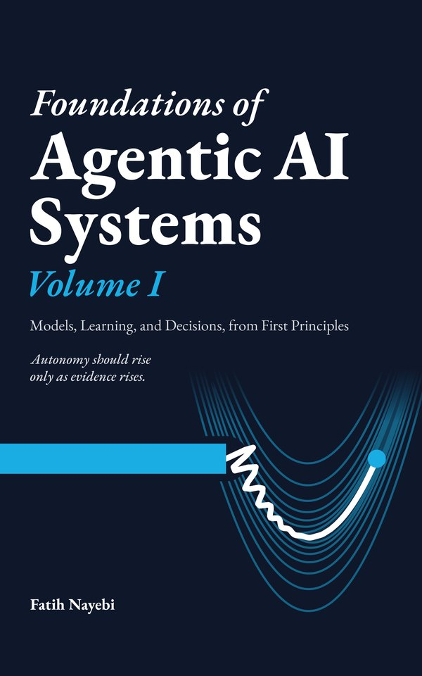
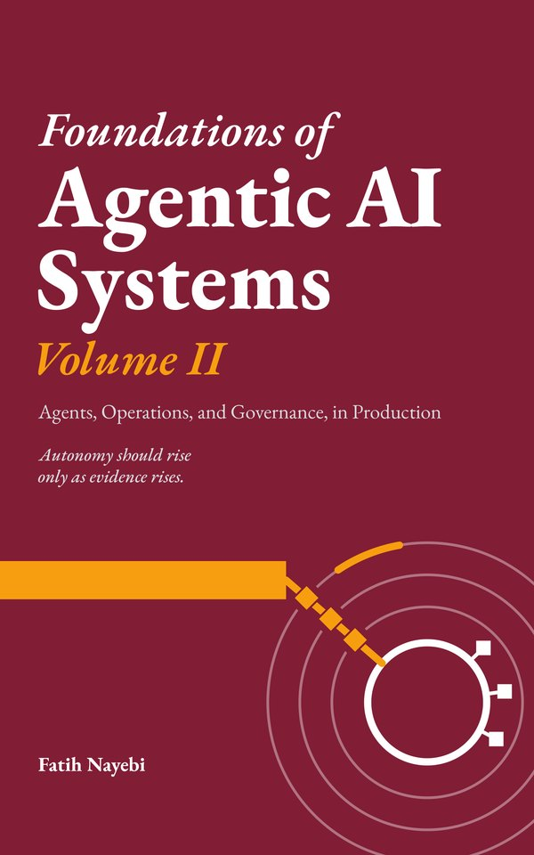
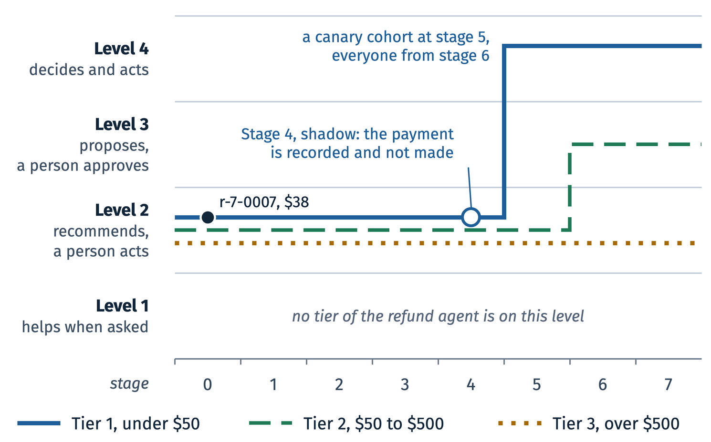
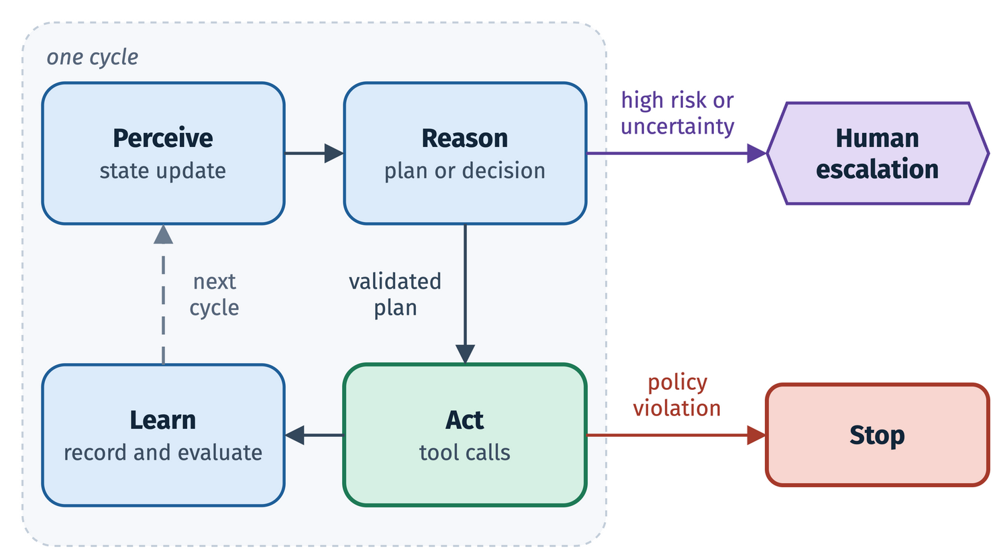
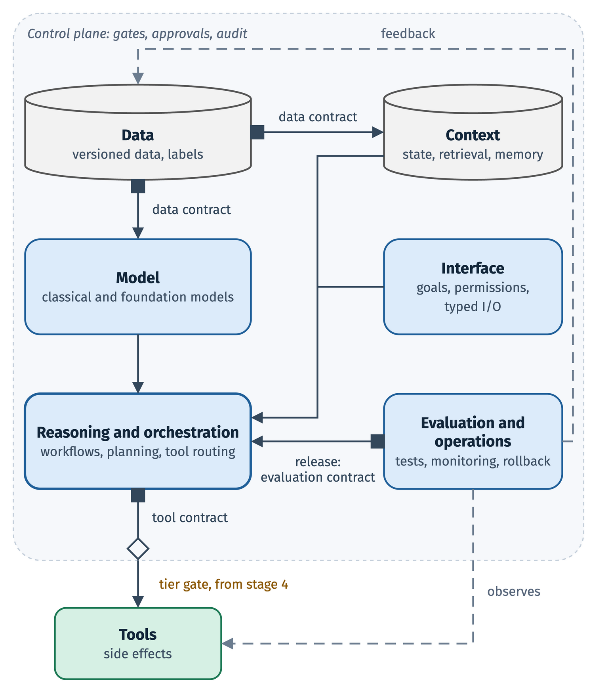
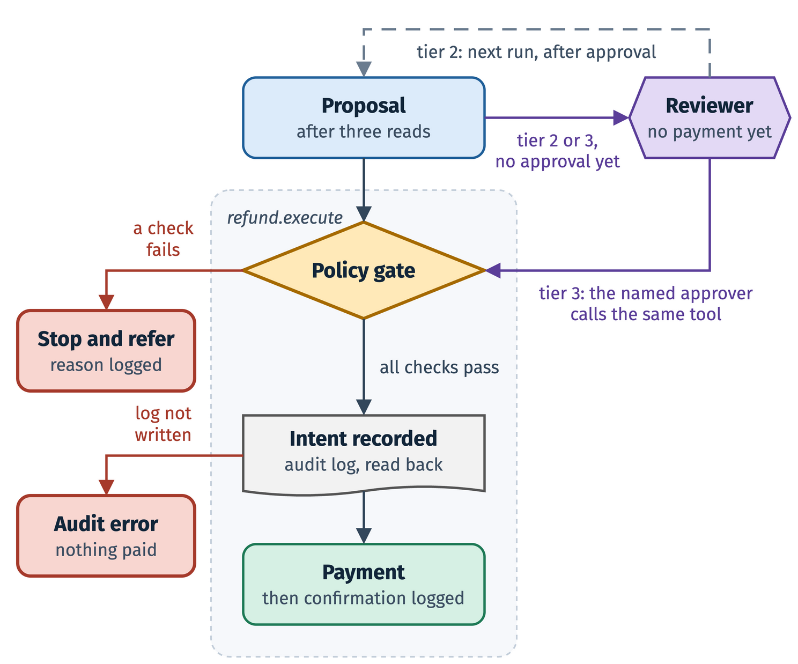

<div align="center">

<a href="https://www.amazon.com/dp/1069422665"></a>&nbsp;&nbsp;&nbsp;&nbsp;<a href="https://www.amazon.com/dp/1069422681"></a>

# Foundations of Agentic AI Systems

**The companion code of both volumes, by Fatih Nayebi**

*Autonomy should rise only as evidence rises.*

[](pyproject.toml)
[](LICENSE)
[](#chapters)
[](book_outputs/)
[](#quick-start)

[**Volume I on Amazon**](https://www.amazon.com/dp/1069422665) · [**Volume II on Amazon**](https://www.amazon.com/dp/1069422681) · [Quick start](#quick-start) · [Chapters](#chapters) · [Report an error](#report-an-error)

</div>

---

*Foundations of Agentic AI Systems* is a book in two volumes about agents that act, and about what an agent must show before it is allowed to. Every program the book prints, and every output it quotes, comes from this repository:

- **The refund agent** ([`refund_agent/`](refund_agent/)), the running example the book follows from its first chapter to its last: an offline refund desk for fictional physical goods that reads orders, shipments and dated policies, drafts a decision, and pays only through a guarded tool into a simulated ledger.
- **The demos** ([`demos/`](demos/)), one script or two for each chapter, which print what the chapter shows.
- **The exercises** ([`exercises/`](exercises/)), with their starters, inputs and acceptance tests.
- **The stored outputs** ([`book_outputs/`](book_outputs/)), the printouts the book quotes, which the demos reproduce.
- **The tests** ([`tests/`](tests/)), which keep the code, the demos and the stored outputs true to one another.

> [!NOTE]
> The demos and the refund agent run offline, without network access or API keys. Their data are constructed or generated from fixed seeds, and the language-model steps are scripted or replayed, so the same command prints the same output each time.


## Four figures from the books

The refund agent begins by only drafting decisions for a person. Each kind of decision gets its own grant of authority: the three refund tiers all start at level 2 and end at three different levels.

<table>
<tr>
<td width="50%" valign="top">

<br><sub><b>Figure 1.3</b>, Volume I, chapter 1, <i>What Is Agentic AI?</i> The refund agent's level of autonomy at each stage, by tier.</sub>
</td>
<td width="50%" valign="top">

<br><sub><b>Figure 22.1</b>, Volume II, chapter 22, <i>The Agentic Loop</i>. One cycle of the agentic loop, with its two guarded exits.</sub>
</td>
</tr>
<tr>
<td width="50%" valign="top">

<br><sub><b>Figure 2.2</b>, Volume I, chapter 2, <i>Architecture, Components and Contracts</i>. The six layers inside the control plane, with contracts at four of its seven boundaries and the tools outside.</sub>
</td>
<td width="50%" valign="top">

<br><sub><b>Figure 25.2</b>, Volume II, chapter 25, <i>Action, Guardrails, and Policies</i>. The path of one refund from proposal to payment.</sub>
</td>
</tr>
</table>

## Quick start

```sh
git clone https://github.com/gradient-divergence/agentic-ai-systems.git
cd agentic-ai-systems
uv sync --extra dev                       # the core and the test tools
source .venv/bin/activate

python -m refund_agent.run --seed 7       # the refund agent on its 40 public scenarios
python -m demos.batch_stream_demo         # one chapter's demo, chapter 31
```

Each chapter has a guide in [`docs/chapters/`](docs/chapters/) that says what its demo shows, how to run it, what the output means and what the code leaves out; the [chapter tables](#chapters) link them all.

## What is in the repository

| Folder | What it holds |
|---|---|
| [`refund_agent/`](refund_agent/) | The refund agent: contracts, tools, the bounded loop, rules, the simulated ledger, audits and traces, plus one subpackage for each later chapter that extends it (`memory/`, `release/`, `batch_stream/`, `canary/` and others) |
| [`demos/`](demos/) | The chapter demos; `demos/data/` holds their frozen inputs and the data behind the book's figures |
| [`exercises/`](exercises/) | Starters, public reference solutions and acceptance tests; the chapter tables name the folders, each with a `README.md` |
| [`book_outputs/`](book_outputs/) | 411 stored outputs, named `_fnd.<chapter>.<name>.txt` |
| [`tests/`](tests/) | The pytest suite; `tests/refund_agent/` covers the agent's core |
| [`spine/`](spine/) | A pipeline over a 100,000-review subset of the Yelp dataset, parts of which several chapters print |
| [`agents/`](agents/) | Minimal policy and tool-registry primitives used by two demos |
| [`supplement/`](supplement/) | Reading beyond the book: an EU AI Act supplement to chapter 37 |
| [`docs/chapters/`](docs/chapters/) | One guide for each chapter |

## Requirements

Python 3.10 or newer. The core dependencies are NumPy, pandas, Pydantic 2, scikit-learn, SciPy, DuckDB and Polars ([`pyproject.toml`](pyproject.toml) gives the versions). A few demos need optional groups of packages, called extras; a chapter's guide names the extra its demo needs, if any.

<details>
<summary>The extras</summary>

| Extra | Packages |
|---|---|
| `ml` | PyTorch, Lightning, sentence-transformers, LightGBM |
| `clustering` | UMAP, HDBSCAN |
| `feature` | Featuretools |
| `autofeat` | autofeat |
| `tsfresh` | tsfresh |
| `causal` | DoWhy |
| `opt` | Optuna, OR-Tools |
| `dev` | pytest, pytest-cov, Ruff, ty |

</details>

## Install

Run every command in this README from the repository's root.

With [uv](https://docs.astral.sh/uv/), which reads the pinned versions in `uv.lock`:

```sh
uv sync --extra dev          # the core and the test tools
uv sync --all-extras         # or everything, the same as `make sync`
source .venv/bin/activate
```

With pip and a virtual environment:

```sh
python3 -m venv .venv
source .venv/bin/activate
python -m pip install -e '.[dev]'
python -m pip install -e '.[dev,ml,clustering,feature,autofeat,tsfresh,causal,opt]'   # optional: every extra
```

Either way the packages are installed in editable mode, so you don't need to set `PYTHONPATH`.

> [!IMPORTANT]
> The durable frozen-set journals used by chapters 4, 5, 6, 8 and 20 require POSIX file locking. Use Linux, macOS or WSL for those runs; native Windows can run examples that do not use those journals.

For an independent rerun of a journaled experiment, choose a fresh directory before starting the demo. Keep an earlier directory when checking its recorded read history; never truncate its journal.

```sh
export BOOK_GOLDEN_DIRECTORY="$(mktemp -d)"
```

## Run one chapter's demo

Each demo is a module of the `demos` package. For chapter 31, Batch and Streaming Pipelines:

```sh
python -m demos.batch_stream_demo
```

It prints, in order, every output chapter 31 quotes. A few chapters print some of their outputs from a second script, and some demos take options, such as a folder for a run's journal; each chapter's guide gives its commands.

## Compare a printout with the stored outputs

Each file in `book_outputs/` holds the printout of one marked region of a demo, the lines between `# region book:fnd.<chapter>.<name> output` and its `# endregion`. To check every stored output of a chapter against a fresh run, save the printout and look for each file in it:

```sh
python -m demos.batch_stream_demo > printout.txt
python - batch-stream <<'EOF'
import sys
from pathlib import Path
printout = Path("printout.txt").read_text()
for stored in sorted(Path("book_outputs").glob(f"_fnd.{sys.argv[1]}.*.txt")):
    print("found  " if stored.read_text() in printout else "missing", stored.name)
EOF
```

Replace `batch-stream` with the chapter's short name, the part of its guide's file name after the number. A file reported missing either differs from your run or comes from another script; the chapter's guide says which scripts print its outputs.

## Run the tests

Some tests expect one thread and no bytecode caches, so set two variables first:

```sh
export OMP_NUM_THREADS=1 PYTHONDONTWRITEBYTECODE=1
python -m pytest                                   # the whole suite
python -m pytest tests/refund_agent                # the refund agent's core
python -m pytest tests/test_batch_stream_demo.py   # one chapter's demo
```

With uv, `make test` runs the suite, `make lint` runs Ruff and `make type` runs the ty type checker; `make all` runs all three. Most chapters' demo tests also compare the demo's output with the stored files. An exercise's acceptance tests live in its folder; its `README.md` says how to point them at your solution.

## The refund agent

`refund_agent/` generates 2,000 orders, 600 labeled requests, five dated policies, a list of reviewers and 40 public scenarios. The agent works with seven tools in a bounded loop and keeps audits and JSON traces. All amounts are in US dollars, held as integer cents.

| Tier | Refund | Who may execute it |
|---|---|---|
| 1 | under $50 | the agent, by itself |
| 2 | $50 to $500 | the agent, after one person approves |
| 3 | over $500 | only a person: the agent prepares a packet for the named approver, who executes it through the guarded tool |

At execution, `refund.execute` reads the order, the shipment and the policy again and checks the ledger balance, the policy version, the return window and the age of each source.

```sh
python -m refund_agent.run --seed 7                   # the 40 public scenarios
python -m refund_agent.run --seed 7 --requests 100    # or the first 100 requests
```

A run writes its scorecards, audits and traces to `refund-output/` (set another folder with `--out`). The same arguments always give the same files.

> [!CAUTION]
> The scores measure agreement with generated labels, which follow the book's fictional rules; they don't measure a model's quality or show that money moved. Policy versions, return windows, caps and the risk threshold are fictional, and the risk score isn't calibrated. There is no live model adapter, no real payment integration and no deployment: `ModelClient` is the boundary where an adapter would go, and an adapter must enforce its own deadline.

<details>
<summary><b>The Yelp review pipeline</b> (<code>spine/</code>)</summary>

`spine/` runs over a 100,000-review subset of the Yelp dataset in `spine/data/subsets/yelp_100k/`. If those JSON files are Git LFS pointers, three short lines of text each, fetch the data with `git lfs pull` first.

```sh
python -m spine.run_spine
python -m spine.ml.run_gbm_baseline --no-lightgbm
python -m spine.ml.run_embedding_clustering
python -m spine.rl.run_policy_eval
python -m spine.ops.run_capstone --no-lightgbm
```

Results are written under `spine/outputs/`. To build the subset from your own copy of the Yelp download, see `python -m spine.data.build_yelp_subset --help`. Read the numbers with two limits in mind: the policy is a rule that reads the star rating of the review it scores, and the user and business features are aggregate statistics. So the metrics show neither that the model predicts without leakage nor that an agent is ready for use.

</details>

## Chapters

Each title links to the chapter's guide, and each demo and exercise folder to its code. A chapter's stored outputs in `book_outputs/` take the name of its guide: chapter 31's guide is `31-batch-stream.md`, so its outputs are `_fnd.batch-stream.*.txt`.

<details>
<summary><b>Volume I</b> · <i>Models, Learning, and Decisions, from First Principles</i> · chapters 1 to 21, Parts I to IV</summary>

#### Part I · Orientation and Agentic Mindset

| Ch. | Chapter and guide | Demo | Exercises |
|---:|---|---|---|
| 1 | [What Is Agentic AI?](docs/chapters/01-what-is-agentic-ai.md) | [`what_is_agentic_ai_demo.py`](demos/what_is_agentic_ai_demo.py) | [`what-is-agentic-ai/`](exercises/what-is-agentic-ai/) |
| 2 | [Architecture, Components and Contracts](docs/chapters/02-modern-ai-stack.md) | [`modern_ai_stack_demo.py`](demos/modern_ai_stack_demo.py) | [`modern-ai-stack/`](exercises/modern-ai-stack/) |
| 3 | [Decision Strategy and Evidence Requirements](docs/chapters/03-data-science-strategy.md) | [`data_science_strategy_demo.py`](demos/data_science_strategy_demo.py) | [`data-science-strategy/`](exercises/data-science-strategy/) |

#### Part II · ML Foundations

| Ch. | Chapter and guide | Demo | Exercises |
|---:|---|---|---|
| 4 | [ML Data and Evaluation](docs/chapters/04-ml-data-and-evaluation.md) | [`ml_data_evaluation_demo.py`](demos/ml_data_evaluation_demo.py) | [`ml-data-and-evaluation/`](exercises/ml-data-and-evaluation/) |
| 5 | [Supervised Learning and Calibrated Risk](docs/chapters/05-supervised-learning.md) | [`supervised_learning_demo.py`](demos/supervised_learning_demo.py) | [`supervised-learning/`](exercises/supervised-learning/) |
| 6 | [Semi- and Self-Supervised Learning and Unlabeled Structure](docs/chapters/06-semi-self-supervised.md) | [`semi_self_supervised_demo.py`](demos/semi_self_supervised_demo.py) | [`semi-self-supervised/`](exercises/semi-self-supervised/) |
| 7 | [Causal Inference and Experiments](docs/chapters/07-causal-inference.md) | [`causal_inference_demo.py`](demos/causal_inference_demo.py) | [`causal-inference/`](exercises/causal-inference/) |
| 8 | [Delegated Model Building](docs/chapters/08-automl-and-selection.md) | [`delegated_model_demo.py`](demos/delegated_model_demo.py), [`delegated_search_lab.py`](demos/delegated_search_lab.py) | [`automl-and-selection/`](exercises/automl-and-selection/) |

#### Part III · Deep Learning Foundations

| Ch. | Chapter and guide | Demo | Exercises |
|---:|---|---|---|
| 9 | [Neural Networks and Backpropagation](docs/chapters/09-neural-networks-backprop.md) | [`backprop_demo.py`](demos/backprop_demo.py) | [`neural-networks-backprop/`](exercises/neural-networks-backprop/) |
| 10 | [Training Optimization and Regularization](docs/chapters/10-optimization-regularization.md) | [`training_control_demo.py`](demos/training_control_demo.py) | [`optimization-regularization/`](exercises/optimization-regularization/) |
| 11 | [Autoencoders and NLP Representations](docs/chapters/11-autoencoders-nlp.md) | [`autoencoders_nlp_demo.py`](demos/autoencoders_nlp_demo.py) | [`autoencoders-nlp/`](exercises/autoencoders-nlp/) |
| 12 | [Sequence Processing, Transformers and Foundation Models](docs/chapters/12-transformers-foundation-models.md) | [`deep_learning_demo.py`](demos/deep_learning_demo.py) | [`transformers-foundation-models/`](exercises/transformers-foundation-models/) |
| 13 | [Generative Models and Simulation](docs/chapters/13-generative-models.md) | [`generative_models_demo.py`](demos/generative_models_demo.py) | [`generative-models/`](exercises/generative-models/) |
| 14 | [Prompting, Fine-Tuning and Retrieval Adaptation](docs/chapters/14-prompting-finetuning-rag.md) | [`adaptation_demo.py`](demos/adaptation_demo.py) | [`prompting-finetuning-rag/`](exercises/prompting-finetuning-rag/) |

#### Part IV · RL and Decision-Making

| Ch. | Chapter and guide | Demo | Exercises |
|---:|---|---|---|
| 15 | [Constrained Optimization for Agentic Decisions](docs/chapters/15-constrained-optimization.md) | [`constrained_optimization_demo.py`](demos/constrained_optimization_demo.py) | [`constrained-optimization/`](exercises/constrained-optimization/) |
| 16 | [Reinforcement Learning Foundations](docs/chapters/16-rl-foundations.md) | [`rl_foundations_demo.py`](demos/rl_foundations_demo.py) | [`rl-foundations/`](exercises/rl-foundations/) |
| 17 | [Exploration, Bandits and Exposure Budgets](docs/chapters/17-exploration-bandits.md) | [`exploration_bandits_demo.py`](demos/exploration_bandits_demo.py) | [`exploration-bandits/`](exercises/exploration-bandits/) |
| 18 | [Deep Reinforcement Learning](docs/chapters/18-deep-rl.md) | [`deep_rl_demo.py`](demos/deep_rl_demo.py) | [`deep-rl/`](exercises/deep-rl/) |
| 19 | [RLHF and Preference Alignment](docs/chapters/19-rlhf-alignment.md) | [`preference_demo.py`](demos/preference_demo.py) | [`rlhf-alignment/`](exercises/rlhf-alignment/) |
| 20 | [Typed Decision Models and Calibrated Decisions](docs/chapters/20-typed-decisions.md) | [`typed_decisions_demo.py`](demos/typed_decisions_demo.py) | [`typed-decisions/`](exercises/typed-decisions/) |
| 21 | [Practical RL and Off-Policy Evaluation](docs/chapters/21-practical-rl.md) | [`practical_rl_demo.py`](demos/practical_rl_demo.py) | [`practical-rl/`](exercises/practical-rl/) |

</details>

<details>
<summary><b>Volume II</b> · <i>Agents, Operations, and Governance, in Production</i> · chapters 22 to 41, Parts V to VIII</summary>

#### Part V · Agentic Systems Architecture

| Ch. | Chapter and guide | Demo | Exercises |
|---:|---|---|---|
| 22 | [The Agentic Loop](docs/chapters/22-agentic-loop.md) | [`agentic_loop_demo.py`](demos/agentic_loop_demo.py) | none |
| 23 | [Perception and Tools](docs/chapters/23-perception-tools.md) | [`perception_tools_demo.py`](demos/perception_tools_demo.py) | [`perception-tools/`](exercises/perception-tools/) |
| 24 | [Reasoning and Validated Planning](docs/chapters/24-reasoning-planning.md) | [`reasoning_planning_demo.py`](demos/reasoning_planning_demo.py) | none |
| 25 | [Action, Guardrails, and Policies](docs/chapters/25-action-guardrails.md) | [`action_guardrails_demo.py`](demos/action_guardrails_demo.py), [`refund_gate_demo.py`](demos/refund_gate_demo.py) | [`action-guardrails/`](exercises/action-guardrails/) |
| 26 | [Memory and Retrieval](docs/chapters/26-memory-rag.md) | [`memory_rag_demo.py`](demos/memory_rag_demo.py) | [`memory-rag/`](exercises/memory-rag/) |
| 27 | [Multi-Agent Systems and Independent Verification](docs/chapters/27-multi-agent-systems.md) | [`multi_agent_systems_demo.py`](demos/multi_agent_systems_demo.py) | [`multi-agent-systems/`](exercises/multi-agent-systems/) |
| 28 | [Agent Frameworks and Orchestration](docs/chapters/28-agent-frameworks.md) | [`agent_frameworks_demo.py`](demos/agent_frameworks_demo.py), [`harness_demo.py`](demos/harness_demo.py) | [`agent-frameworks/`](exercises/agent-frameworks/) |
| 29 | [Agent Evaluation and Release Evidence](docs/chapters/29-agent-evaluation.md) | [`agent_evaluation_release_demo.py`](demos/agent_evaluation_release_demo.py) | [`agent-evaluation/`](exercises/agent-evaluation/) |

#### Part VI · Engineering and Operations

| Ch. | Chapter and guide | Demo | Exercises |
|---:|---|---|---|
| 30 | [Data Systems for Agentic AI](docs/chapters/30-data-systems.md) | [`data_systems_demo.py`](demos/data_systems_demo.py) | [`data-systems/`](exercises/data-systems/) |
| 31 | [Batch and Streaming Pipelines](docs/chapters/31-batch-stream.md) | [`batch_stream_demo.py`](demos/batch_stream_demo.py) | [`batch-stream/`](exercises/batch-stream/) |
| 32 | [Deployment and Rollback](docs/chapters/32-cloud-native-deployment.md) | [`cloud_native_deployment_demo.py`](demos/cloud_native_deployment_demo.py) | [`cloud-native-deployment/`](exercises/cloud-native-deployment/) |
| 33 | [MLOps and ML Engineering](docs/chapters/33-mlops-mle.md) | [`mlops_mle_demo.py`](demos/mlops_mle_demo.py) | [`mlops-mle/`](exercises/mlops-mle/) |
| 34 | [Observability and Reliability](docs/chapters/34-observability-reliability.md) | [`observability_reliability_demo.py`](demos/observability_reliability_demo.py) | [`observability-reliability/`](exercises/observability-reliability/) |
| 35 | [Security and Privacy](docs/chapters/35-security-privacy.md) | [`security_privacy_demo.py`](demos/security_privacy_demo.py), [`security_privacy_integration_demo.py`](demos/security_privacy_integration_demo.py) | [`security-privacy/`](exercises/security-privacy/) |

#### Part VII · Governance and Adoption

| Ch. | Chapter and guide | Demo | Exercises |
|---:|---|---|---|
| 36 | [Outcome Audits and Decision Explanations](docs/chapters/36-audits-explanations.md) | [`audits_explanations_demo.py`](demos/audits_explanations_demo.py), [`audits_explanations_integrated_capture.py`](demos/audits_explanations_integrated_capture.py) | [`audits-explanations/`](exercises/audits-explanations/) |
| 37 | [Human Oversight and Risk Management](docs/chapters/37-human-oversight-risk.md) | [`human_oversight_risk_demo.py`](demos/human_oversight_risk_demo.py) | [`human-oversight-risk/`](exercises/human-oversight-risk/) |
| 38 | [Organizational Adoption](docs/chapters/38-org-adoption.md) | [`org_adoption_demo.py`](demos/org_adoption_demo.py) | [`org-adoption/`](exercises/org-adoption/) |

#### Part VIII · Capstone and Futures

| Ch. | Chapter and guide | Demo | Exercises |
|---:|---|---|---|
| 39 | [Capstone: Design, Build, Deploy, Operate](docs/chapters/39-capstone-blueprint.md) | [`capstone_blueprint_demo.py`](demos/capstone_blueprint_demo.py) | [`capstone-blueprint/`](exercises/capstone-blueprint/) |
| 40 | [Domain-Agnostic Transfer Cases](docs/chapters/40-case-studies-domain-agnostic.md) | [`case_studies_domain_agnostic_demo.py`](demos/case_studies_domain_agnostic_demo.py) | [`case-studies-domain-agnostic/`](exercises/case-studies-domain-agnostic/) |
| 41 | [Future Directions and System Renewal](docs/chapters/41-future-directions.md) | [`future_directions_demo.py`](demos/future_directions_demo.py) | [`future-directions/`](exercises/future-directions/) |

</details>

The appendix on mathematical foundations has its own demo, [`demos/appendix_math_demo.py`](demos/appendix_math_demo.py), and stored outputs, `_fnd.appendix-math-foundations.*`. A held-out evaluation package used for grading is not part of this code.

## The books

<table>
<tr>
<td width="50%" valign="top">

**[Volume I](https://www.amazon.com/dp/1069422665)** · *Models, Learning, and Decisions, from First Principles*

*First principles for production agentic systems that can be judged.* Volume I follows one running example, a refund agent, from its first day, when it only drafts decisions for a person, to the day every proposal it makes stands beside its evidence, its baseline and a verdict. Each method arrives as something the agent must show before it may act: calibrated probabilities and the costs behind a threshold, causal effects, neural networks and language models, reinforcement learning and off-policy evaluation.

Chapters 1 to 21, Parts I to IV<br>Hardcover · ISBN&nbsp;978-1-0694226-6-8<br>Paperback · ISBN&nbsp;978-1-0694226-3-7

</td>
<td width="50%" valign="top">

**[Volume II](https://www.amazon.com/dp/1069422681)** · *Agents, Operations, and Governance, in Production*

*Every grant of authority, earned on evidence named in advance.* Volume II builds the refund agent of Volume I for production. It gives the agent a loop that ends every run in a known way, a gate inside the call that pays, an independent verifier, and a release suite that earns shadow mode: every decision made and recorded, no money moved.

Chapters 22 to 41, Parts V to VIII<br>Hardcover · ISBN&nbsp;978-1-0694226-8-2<br>Paperback · ISBN&nbsp;978-1-0694226-7-5

</td>
</tr>
</table>

Published by Gradient Divergence, Montréal, 2026.

## About the author

Fatih Nayebi is Assistant Professor in Information Systems at McGill University, where since 2019 he has taught the five graduate courses these volumes hold: Enterprise Data Science, Machine Learning in Production, Introduction to AI and Deep Learning, Applications and Architectures of Deep Learning, and Designing and Building Agentic AI Systems. As founder and CEO of OODARIS AI, he builds real-world, production multi-agent systems that make autonomous decisions, combining machine learning, ML engineering, deep reinforcement learning, operations research and software engineering, and that act only within the authority they have earned.

## Report an error

Found a mistake in the text, a figure, a listing or an output? Please [report it as an issue](https://github.com/gradient-divergence/agentic-ai-systems/issues/new?template=erratum.yml), with the volume, the chapter and the page. For a problem running the code, [open a code issue](https://github.com/gradient-divergence/agentic-ai-systems/issues/new?template=code-problem.yml).

## Cite

<details>
<summary>BibTeX</summary>

```bibtex
@book{nayebi2026agenticI,
  author    = {Fatih Nayebi},
  title     = {Foundations of Agentic AI Systems, Volume I: Models, Learning, and Decisions, from First Principles},
  publisher = {Gradient Divergence},
  address   = {Montr{\'e}al},
  year      = {2026},
  isbn      = {978-1-0694226-6-8}
}

@book{nayebi2026agenticII,
  author    = {Fatih Nayebi},
  title     = {Foundations of Agentic AI Systems, Volume II: Agents, Operations, and Governance, in Production},
  publisher = {Gradient Divergence},
  address   = {Montr{\'e}al},
  year      = {2026},
  isbn      = {978-1-0694226-8-2}
}
```

</details>

GitHub's *Cite this repository* button reads [`CITATION.cff`](CITATION.cff).

## License

The code is released under the MIT License; see [`LICENSE`](LICENSE). The cover images and the figures reproduced from the books, in `docs/assets/`, are © 2026 Fatih Nayebi, all rights reserved, and are not covered by the MIT License.
